</img>

  

## About Me

- Currently working at **Kratos Defense & Security Solutions**.
- Specialize in **Microservice Architecture, Middleware Design, SATCOM, Ground Systems, & C2 Services**.
- 2019 Graduate of **Salisbury University** with a Bachelor's in **Computer Science**.
- My GitHub is for personal projects, learning new tools/languages, & contributing to the open source community!
- Feel free to reach out to me at my pinned socials below.

## Github Trophies

## Featured Repositories

<!-- FEATURED_REPOSITORIES_START -->

  
  
  
  
  
  

<!-- FEATURED_REPOSITORIES_END -->

## Active Languages Chart

## My Statistics

  

## Chess Statistics

<!--START_SECTION:chessStats-->
<!-- Automatically generated with https://github.com/Balastrong/chess-stats-action -->

| Type | Rapid ⏲️ | Blitz ⚡ | Bullet 🔫 |
|:---:|:---:|:---:|:---:|
| Current | 968 | 570 | 187 |
| Best | 1227 | 748 | 370 |

| White ⚪ | Black ⚫ | Result 🏆 | Date 📅 | Position 🗺️ | Type 🕕 |
|:---:|:---:|:---:|:---:|:---:|:---:|
| 123hohohoo | **xTriixrx** | repetition ⏸️ | 23/11/2026 | <a href="http://www.ee.unb.ca/cgi-bin/tervo/fen.pl?select=8/1k6/1p6/p2R4/P7/2P5/K7/1r6 b - - 18 46">Link</a> | Rapid |
| Czar2727 | **xTriixrx** | resigned ❌ | 22/11/2026 | <a href="http://www.ee.unb.ca/cgi-bin/tervo/fen.pl?select=8/8/2p2K2/3k4/1P1B4/2P5/8/8 b - - 4 52">Link</a> | Rapid |
| **xTriixrx** | SSSHHH1111 | resigned ❌ | 21/11/2026 | <a href="http://www.ee.unb.ca/cgi-bin/tervo/fen.pl?select=4r1k1/p2b3p/2n1p1pB/q4r2/1b1PQ3/2N4P/PP3PP1/R3R1K1 w - - 3 22">Link</a> | Rapid |
| Max2_345 | **xTriixrx** | win 🥇 | 21/11/2026 | <a href="http://www.ee.unb.ca/cgi-bin/tervo/fen.pl?select=5k2/5p2/4pb2/8/8/6P1/4K3/q7 w - - 0 45">Link</a> | Rapid |
| **xTriixrx** | rafihrl | repetition ⏸️ | 21/11/2026 | <a href="http://www.ee.unb.ca/cgi-bin/tervo/fen.pl?select=8/8/8/6k1/8/5RP1/r5K1/8 w - - 13 75">Link</a> | Rapid |
| **xTriixrx** | Adnkaa1 | win 🥇 | 21/11/2026 | <a href="http://www.ee.unb.ca/cgi-bin/tervo/fen.pl?select=r4rk1/p4ppp/4pN2/3p3b/3p4/2Q1P2P/P4PP1/R1B2RK1 b - - 0 18">Link</a> | Rapid |
| **xTriixrx** | frogintherain | resigned ❌ | 20/11/2026 | <a href="http://www.ee.unb.ca/cgi-bin/tervo/fen.pl?select=rn2kb1r/pp3p1p/2p1p3/4Pqp1/3P2n1/2N5/PP3PPP/R1BQ1RK1 w kq - 0 13">Link</a> | Rapid |
| LLEGANYA | **xTriixrx** | resigned ❌ | 20/11/2026 | <a href="http://www.ee.unb.ca/cgi-bin/tervo/fen.pl?select=r1b3k1/2p3Pp/2p1q1n1/p1Npp3/5rP1/3Q1P2/PPP5/2KR1B1R b - - 4 20">Link</a> | Rapid |
| alexandermvulane | **xTriixrx** | resigned ❌ | 20/11/2026 | <a href="http://www.ee.unb.ca/cgi-bin/tervo/fen.pl?select=r1bq1rk1/pp1p1ppp/2n1p3/4P3/1b1P1B2/2NB1N2/PP3PPP/R2QK2R b KQ - 0 10">Link</a> | Rapid |
| **xTriixrx** | sakib26 | resigned ❌ | 20/11/2026 | <a href="http://www.ee.unb.ca/cgi-bin/tervo/fen.pl?select=r3k2r/p4ppp/2p5/3p4/Q1pPn3/2P1P3/P4PPP/1qB2RK1 w kq - 0 17">Link</a> | Rapid |

<!--END_SECTION:chessStats-->

 

<!-- Dev Joke -->

<i>A dev joke for making it this far!</i>

<!-- Footer -->

 

<i>The key to immortality is living a life worth remembering. - Bruce Lee</i>

