</img>

  

## About Me

- Currently working at **Kratos Defense & Security Solutions**.
- Specialize in **Microservice Architecture, Middleware Design, SATCOM, Ground Systems, & C2 Services**.
- 2019 Graduate of **Salisbury University** with a Bachelor's in **Computer Science**.
- My GitHub is for personal projects, learning new tools/languages, & contributing to the open source community!
- Feel free to reach out to me at my pinned socials below.

## Github Trophies

## Featured Repositories

<!-- FEATURED_REPOSITORIES_START -->

  
  
  
  
  
  

<!-- FEATURED_REPOSITORIES_END -->

## Active Languages Chart

## My Statistics

  

## Chess Statistics

<!--START_SECTION:chessStats-->
<!-- Automatically generated with https://github.com/Balastrong/chess-stats-action -->

| Type | Rapid ⏲️ | Blitz ⚡ | Bullet 🔫 |
|:---:|:---:|:---:|:---:|
| Current | 1031 | 570 | 187 |
| Best | 1227 | 748 | 370 |

| White ⚪ | Black ⚫ | Result 🏆 | Date 📅 | Position 🗺️ | Type 🕕 |
|:---:|:---:|:---:|:---:|:---:|:---:|
| **xTriixrx** | Lemeza83 | win 🥇 | 8/11/2026 | <a href="http://www.ee.unb.ca/cgi-bin/tervo/fen.pl?select=8/p3n3/2p5/4k1pp/4Pp2/3N1P1P/6P1/3R2K1 b - - 2 35">Link</a> | Rapid |
| andrewgottheight2 | **xTriixrx** | win 🥇 | 8/11/2026 | <a href="http://www.ee.unb.ca/cgi-bin/tervo/fen.pl?select=8/8/8/8/8/2k5/1q6/1K6 w - - 8 77">Link</a> | Rapid |
| **xTriixrx** | 1Bartolomeo2 | resigned ❌ | 8/11/2026 | <a href="http://www.ee.unb.ca/cgi-bin/tervo/fen.pl?select=r4b1r/p4npp/2k5/8/RB6/8/1P3PPP/6K1 w - - 0 29">Link</a> | Rapid |
| bigdaddyplant | **xTriixrx** | win 🥇 | 8/11/2026 | <a href="http://www.ee.unb.ca/cgi-bin/tervo/fen.pl?select=6k1/6p1/1p1p3p/1P1P2b1/2r2r2/7P/6PK/8 w - - 0 42">Link</a> | Rapid |
| **xTriixrx** | DeeEmperor | win 🥇 | 8/11/2026 | <a href="http://www.ee.unb.ca/cgi-bin/tervo/fen.pl?select=rn1R1k1r/pp3pp1/2p1p2p/8/4R3/1P3B1P/P1P2PP1/6K1 b - - 1 18">Link</a> | Rapid |
| **xTriixrx** | tinku966 | win 🥇 | 8/11/2026 | <a href="http://www.ee.unb.ca/cgi-bin/tervo/fen.pl?select=6r1/1k6/2r2B1p/p5p1/P7/1PN3R1/5PPP/R5K1 b - - 0 35">Link</a> | Rapid |
| vibing_beanz | **xTriixrx** | resigned ❌ | 8/11/2026 | <a href="http://www.ee.unb.ca/cgi-bin/tervo/fen.pl?select=8/5p2/3k2p1/8/3p4/3K4/5P1p/7R b - - 1 49">Link</a> | Rapid |
| **xTriixrx** | JakeViolet | win 🥇 | 8/11/2026 | <a href="http://www.ee.unb.ca/cgi-bin/tervo/fen.pl?select=5rk1/pp6/3pN1q1/3Pp1Np/2P5/8/PP6/5n1K b - - 1 38">Link</a> | Rapid |
| rezasasanfar777 | **xTriixrx** | win 🥇 | 8/11/2026 | <a href="http://www.ee.unb.ca/cgi-bin/tervo/fen.pl?select=r1b1k2r/pppp1ppp/5n2/2b1p3/2B1P3/3PBP2/PPn3qP/RN1QKR2 w Qkq - 0 9">Link</a> | Rapid |
| **xTriixrx** | gameon112 | resigned ❌ | 8/11/2026 | <a href="http://www.ee.unb.ca/cgi-bin/tervo/fen.pl?select=8/3qP3/R4K2/5p1k/5P2/4P3/7p/8 w - - 0 50">Link</a> | Rapid |

<!--END_SECTION:chessStats-->

 

<!-- Dev Joke -->

<i>A dev joke for making it this far!</i>

<!-- Footer -->

 

<i>The key to immortality is living a life worth remembering. - Bruce Lee</i>

