</img>

  

## About Me

- Currently working at **Kratos Defense & Security Solutions**.
- Specialize in **Microservice Architecture, Middleware Design, SATCOM, Ground Systems, & C2 Services**.
- 2019 Graduate of **Salisbury University** with a Bachelor's in **Computer Science**.
- My GitHub is for personal projects, learning new tools/languages, & contributing to the open source community!
- Feel free to reach out to me at my pinned socials below.

## Github Trophies

## Featured Repositories

<!-- FEATURED_REPOSITORIES_START -->

  
  
  
  
  
  

<!-- FEATURED_REPOSITORIES_END -->

## Active Languages Chart

## My Statistics

  

## Chess Statistics

<!--START_SECTION:chessStats-->
<!-- Automatically generated with https://github.com/Balastrong/chess-stats-action -->

| Type | Rapid ⏲️ | Blitz ⚡ | Bullet 🔫 |
|:---:|:---:|:---:|:---:|
| Current | 1016 | 570 | 187 |
| Best | 1227 | 748 | 370 |

| White ⚪ | Black ⚫ | Result 🏆 | Date 📅 | Position 🗺️ | Type 🕕 |
|:---:|:---:|:---:|:---:|:---:|:---:|
| **xTriixrx** | SrikarA98 | repetition ⏸️ | 10/10/2026 | <a href="http://www.ee.unb.ca/cgi-bin/tervo/fen.pl?select=7B/7B/8/2K5/8/1k6/8/8 b - - 88 96">Link</a> | Rapid |
| Zedtemat | **xTriixrx** | resigned ❌ | 10/10/2026 | <a href="http://www.ee.unb.ca/cgi-bin/tervo/fen.pl?select=r4rk1/1p1q1p1p/2p2Pp1/p2p1b2/P7/2P1B2P/2P1BPP1/1R1Q1RK1 w - - 0 16">Link</a> | Rapid |
| **xTriixrx** | Hatef-Gh | win 🥇 | 10/10/2026 | <a href="http://www.ee.unb.ca/cgi-bin/tervo/fen.pl?select=8/8/p7/P1QQ4/8/2k2P2/3RB1K1/8 b - - 7 71">Link</a> | Rapid |
| **xTriixrx** | cipy1987 | win 🥇 | 9/10/2026 | <a href="http://www.ee.unb.ca/cgi-bin/tervo/fen.pl?select=r3k2r/2qnQppp/p3p3/8/2nP4/B1P1PP2/5P1P/R3K2R b KQkq - 1 18">Link</a> | Rapid |
| usrok10 | **xTriixrx** | resigned ❌ | 9/10/2026 | <a href="http://www.ee.unb.ca/cgi-bin/tervo/fen.pl?select=6k1/1pp2ppp/8/p1P5/P6R/1PB2QP1/6K1/3r4 b - - 0 34">Link</a> | Rapid |
| Agustinelmascapito | **xTriixrx** | win 🥇 | 8/10/2026 | <a href="http://www.ee.unb.ca/cgi-bin/tervo/fen.pl?select=r1bq1rk1/pp2bpp1/2n1pn1p/3p1NB1/2P5/2N3P1/PP2PPBP/R2Q1RK1 b - - 1 10">Link</a> | Rapid |
| ZibbleZorpie | **xTriixrx** | agreed ⏸️ | 8/10/2026 | <a href="http://www.ee.unb.ca/cgi-bin/tervo/fen.pl?select=8/8/5p1p/2pk4/p5PP/P1K5/1P6/8 b - - 3 37">Link</a> | Rapid |
| **xTriixrx** | sirknight209 | win 🥇 | 8/10/2026 | <a href="http://www.ee.unb.ca/cgi-bin/tervo/fen.pl?select=8/6k1/5R2/6P1/3B2Pp/7P/7K/1r6 b - - 6 52">Link</a> | Rapid |
| **xTriixrx** | Anshul527 | resigned ❌ | 8/10/2026 | <a href="http://www.ee.unb.ca/cgi-bin/tervo/fen.pl?select=1rb1B1k1/p4p1p/n4p2/8/8/1Pb5/P1P2PPP/R5K1 w - - 0 22">Link</a> | Rapid |
| **xTriixrx** | rahanne | win 🥇 | 7/10/2026 | <a href="http://www.ee.unb.ca/cgi-bin/tervo/fen.pl?select=8/pp2n3/3kp3/8/6PP/1P1p1RK1/P7/8 b - - 1 36">Link</a> | Rapid |

<!--END_SECTION:chessStats-->

 

<!-- Dev Joke -->

<i>A dev joke for making it this far!</i>

<!-- Footer -->

 

<i>The key to immortality is living a life worth remembering. - Bruce Lee</i>

