</img>

  

## About Me

- Currently working at **Kratos Defense & Security Solutions**.
- Specialize in **Microservice Architecture, Middleware Design, SATCOM, Ground Systems, & C2 Services**.
- 2019 Graduate of **Salisbury University** with a Bachelor's in **Computer Science**.
- My GitHub is for personal projects, learning new tools/languages, & contributing to the open source community!
- Feel free to reach out to me at my pinned socials below.

## Github Trophies

## Featured Repositories

<!-- FEATURED_REPOSITORIES_START -->

  
  
  
  
  
  

<!-- FEATURED_REPOSITORIES_END -->

## Active Languages Chart

## My Statistics

  

## Chess Statistics

<!--START_SECTION:chessStats-->
<!-- Automatically generated with https://github.com/Balastrong/chess-stats-action -->

| Type | Rapid ⏲️ | Blitz ⚡ | Bullet 🔫 |
|:---:|:---:|:---:|:---:|
| Current | 992 | 570 | 187 |
| Best | 1227 | 748 | 370 |

| White ⚪ | Black ⚫ | Result 🏆 | Date 📅 | Position 🗺️ | Type 🕕 |
|:---:|:---:|:---:|:---:|:---:|:---:|
| majkel8223 | **xTriixrx** | checkmated ❌ | 15/11/2026 | <a href="http://www.ee.unb.ca/cgi-bin/tervo/fen.pl?select=Q6r/pR1kb3/2ppppqp/4p3/P3P3/2PP2P1/5P1P/2B1K2R b K - 2 23">Link</a> | Rapid |
| Mr_Turtlesteiner | **xTriixrx** | checkmated ❌ | 15/11/2026 | <a href="http://www.ee.unb.ca/cgi-bin/tervo/fen.pl?select=7r/5P2/8/2p5/8/3K4/1p6/2k2R2 b - - 1 61">Link</a> | Rapid |
| **xTriixrx** | MakisGre | win 🥇 | 15/11/2026 | <a href="http://www.ee.unb.ca/cgi-bin/tervo/fen.pl?select=2b2rk1/5p2/p1pQq1pp/1p2P3/8/2PB4/2P2PPP/3RR1K1 b - - 0 22">Link</a> | Rapid |
| **xTriixrx** | ThiliSandaruwani | resigned ❌ | 15/11/2026 | <a href="http://www.ee.unb.ca/cgi-bin/tervo/fen.pl?select=r1b2rk1/ppp2ppp/2n1p3/3p2N1/3P4/2P5/P1PnBPPP/R4RK1 w - - 0 14">Link</a> | Rapid |
| 1709Lucasje2015 | **xTriixrx** | resigned ❌ | 15/11/2026 | <a href="http://www.ee.unb.ca/cgi-bin/tervo/fen.pl?select=8/pp5p/8/2P1k1p1/4P3/4K3/P7/7R b - - 3 38">Link</a> | Rapid |
| **xTriixrx** | alfaleon | win 🥇 | 15/11/2026 | <a href="http://www.ee.unb.ca/cgi-bin/tervo/fen.pl?select=2N5/6kp/5np1/3PB3/1b6/1P2PP2/5P2/5RK1 b - - 0 24">Link</a> | Rapid |
| Honey00787 | **xTriixrx** | resigned ❌ | 15/11/2026 | <a href="http://www.ee.unb.ca/cgi-bin/tervo/fen.pl?select=5rk1/N4ppp/1ppr1n2/4P2b/8/7P/PPP2PP1/R1B2RK1 b - - 0 16">Link</a> | Rapid |
| KarthikRaj04 | **xTriixrx** | win 🥇 | 15/11/2026 | <a href="http://www.ee.unb.ca/cgi-bin/tervo/fen.pl?select=r2q1rk1/ppp2pp1/3p3p/2bNp3/2BnP2P/3P1b2/PPPQ1PP1/R3K1R1 w Q - 0 13">Link</a> | Rapid |
| **xTriixrx** | EK752 | resigned ❌ | 15/11/2026 | <a href="http://www.ee.unb.ca/cgi-bin/tervo/fen.pl?select=6k1/pp3p1p/2p1nPpQ/8/4P1P1/4B2P/PPq2PK1/8 w - - 4 27">Link</a> | Rapid |
| **xTriixrx** | giushdzma | win 🥇 | 15/11/2026 | <a href="http://www.ee.unb.ca/cgi-bin/tervo/fen.pl?select=q7/8/7p/4BQpk/p5P1/7K/5P1P/8 b - - 0 43">Link</a> | Rapid |

<!--END_SECTION:chessStats-->

 

<!-- Dev Joke -->

<i>A dev joke for making it this far!</i>

<!-- Footer -->

 

<i>The key to immortality is living a life worth remembering. - Bruce Lee</i>

